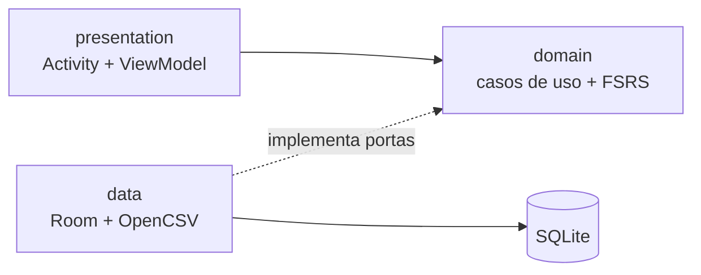
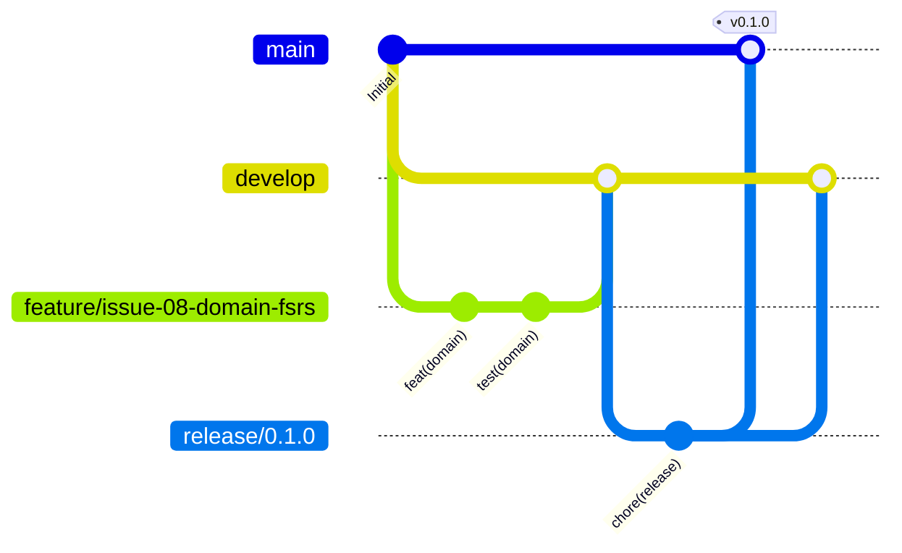

# Cerebro — Repetição Espaçada Offline para Simulados AWS

> Aplicativo Android nativo que transforma os seus simulados de certificação AWS em uma fila de revisão inteligente, calculada no próprio celular, sem conta, sem servidor e sem internet.

[](https://github.com/MarkosFerreiraTech/android-spaced-repetition/actions/workflows/ci.yml)
[](LICENSE)
-3DDC84?logo=android&logoColor=white)


---

## 📌 O problema

Quem se prepara para certificações AWS depende de simulados de múltipla escolha. O ciclo habitual é: faz o simulado, olha a nota, segue adiante. O resultado é previsível — o conteúdo revisado na segunda-feira desaparece antes da prova, e **os mesmos erros se repetem no simulado seguinte**.

As plataformas existentes resolvem isso mal por três motivos: não priorizam o que você erra, não agendam revisão e exigem conexão com uma conta.

## 💡 A solução

O **Cerebro** fecha esse ciclo:

1. Você **importa** o banco de questões que já tem, a partir de uma planilha CSV.
2. Faz o simulado normalmente — **65 questões, 20 erros**.
3. No dia seguinte, escolhe como refazer: **tudo (65)**, **só os erros (20)** ou **erros + as que marcou como duvidosas (27)**.
4. O app calcula, **localmente**, quando cada questão deve reaparecer, usando **FSRS** — o estado da arte em repetição espaçada.

| Resultado na questão | Rating FSRS | Efeito no agendamento |
|---|---|---|
| Errou | `Again` | Volta em 1 dia, dificuldade sobe |
| Acertou, mas marcou "acertei com dúvida" | `Hard` | Intervalo curto |
| Acertou | `Good` | Intervalo padrão |
| Acertou rápido e sem marcação | `Easy` | Intervalo longo |

## ✅ Funcionalidades

### Implementado

| Área | Entrega |
|---|---|
| **Documentação** | Project Charter, 26 RFs + 21 RNFs, 6 casos de uso, 12 user stories em Gherkin, arquitetura C4, DER e 6 ADRs |
| **Domínio (Java puro)** | Algoritmo FSRS completo: estabilidade, dificuldade, curva de esquecimento, intervalos com limites |
| **Casos de uso** | Importação de baralho, montagem da fila nos 3 modos, início e persistência de sessão, resposta com reagendamento |
| **Política de rating** | Tradução do resultado do simulado em rating FSRS |
| **Persistência** | Room com 4 entidades, índices (incluindo `content_hash` único), 6 adaptadores implementando as portas de saída |
| **Arquitetura** | Clean Architecture + MVVM, 6 portas de domínio, injeção por construtor, mappers que impedem vazamento de entidades |
| **Importação** | Parser OpenCSV com RFC 4180, cabeçalho validado e erro por linha que não interrompe o arquivo |
| **Qualidade** | JUnit 5 + AssertJ + Mockito, ArchUnit com 10 regras de camada, JaCoCo com gate (80% global / 95% domínio), Checkstyle, SpotBugs |
| **CI/CD** | GitHub Actions com 4 jobs: build+testes+cobertura+APK, análise estática, segurança, SonarCloud. Qodana como análise complementar |
| **DevSecOps** | `EncryptedSharedPreferences` com MasterKey AES256-GCM no Keystore, classificação de dados, gitleaks, ausência da permissão `INTERNET` |
| **Arquitetura de app** | Composition root sem framework (`AppContainer`), `CerebroApplication`, executor serial para importação |

### Planejado

| Issue | Entrega |
|---|---|
| [#12](https://github.com/MarkosFerreiraTech/android-spaced-repetition/issues/12) | Telas de importação e listagem de baralhos (XML + ViewBinding + Material 3) |
| [#13](https://github.com/MarkosFerreiraTech/android-spaced-repetition/issues/13) | Tela de sessão de estudo com os três modos |
| [#14](https://github.com/MarkosFerreiraTech/android-spaced-repetition/issues/14) | Tela de estatísticas e progresso |
| [#19](https://github.com/MarkosFerreiraTech/android-spaced-repetition/issues/19) | Release v1.0.0 com APK |

Os ViewModels seguem o padrão MVVM e são testados em JVM pura com
`InstantTaskExecutorRule`; as Activities são casca fina que apenas observa estado.

## 🚀 Como executar

### Pré-requisitos

| Ferramenta | Versão |
|---|---|
| JDK | 17 (Temurin recomendado) |
| Android Studio | Ladybug ou superior |
| Android SDK | Platform 35, Build Tools 35.0.0 |
| Git | 2.40+ |

### Passos

```bash
# 1. Clone
git clone https://github.com/MarkosFerreiraTech/android-spaced-repetition.git
cd android-spaced-repetition

# 2. Aponte o SDK (ou abra no Android Studio, que cria o local.properties)
echo "sdk.dir=$HOME/Android/Sdk" > local.properties

# 3. Build do APK de debug
./gradlew assembleDebug
# saída: build/outputs/apk/debug/*.apk

# 4. Testes unitários
./gradlew testDebugUnitTest

# 5. Cobertura + portão de qualidade
./gradlew jacocoTestReport jacocoTestCoverageVerification
# relatório: build/reports/jacoco/jacocoTestReport/html/index.html

# 6. Análise estática
./gradlew checkstyleMain spotbugsMain
```

### Instalação no dispositivo

```bash
adb install -r build/outputs/apk/debug/app-debug.apk
```

O APK de debug também é publicado como artefato em cada execução verde do CI.

## 📖 Documentação

| Documento | Conteúdo |
|---|---|
| [Termo de Abertura (Charter)](docs/project-charter.md) | Justificativa, visão, 6 objetivos SMART, escopo dentro/fora, cronograma M1–M4, riscos, decisões D1–D6 |
| [Requisitos](docs/requisitos.md) | 26 RFs e 21 RNFs numerados, com prioridade MoSCoW e método de verificação |
| [Casos de Uso](docs/casos-de-uso.md) | Atores, 6 UCs com fluxo principal, alternativos e tabelas de exceção |
| [User Stories](docs/user-stories.md) | 12 histórias canônicas com critérios de aceite em Gherkin e story points |
| [Arquitetura](docs/arquitetura.md) | C4 níveis 1 e 2, camadas, diagrama de classes, DER do Room, fluxos de sequência |
| [ADRs](docs/adr/) | 6 decisões arquiteturais com contexto, alternativas e consequências |
| [Segurança](docs/seguranca.md) | Classificação de dados e mecanismos de proteção |
| [Versionamento](docs/VERSIONAMENTO.md) | Conventional Commits, Git Flow, política SemVer, tags anotadas e checklist de release |
| [Changelog](CHANGELOG.md) | Histórico de versões no padrão Keep a Changelog |
| [Como contribuir](CONTRIBUTING.md) | Fluxo de branches, padrão de commits e instalação do hook de validação |

### Convenção do CSV

O arquivo deve ser texto delimitado por `,` ou `;`, em UTF-8, com o cabeçalho:

```csv
question,option_a,option_b,option_c,option_d,correct_answer,explanation
"Qual serviço oferece armazenamento de objetos com durabilidade de 11 noves?",S3,EBS,EFS,Glacier,A,"S3 é o serviço de object storage da AWS."
```

Colunas `option_e` e `explanation` são opcionais. Linhas inválidas não abortam a importação: são reportadas com número de linha e motivo. Reimportar a mesma planilha **atualiza** as questões e **preserva o histórico** de revisões.

## 🏗️ Arquitetura

```
src/main/java/com/markosferreira/spacedrepetition/
├── domain/               ← Java puro. Não importa android.*, Room ou UI.
│   ├── model/            Card, Deck, ReviewLog, StudySession, SchedulingInfo
│   ├── fsrs/             FsrsScheduler + FsrsParameters (os 18 pesos)
│   ├── port/             6 portas de repositório + ReviewScheduler + CsvParser
│   ├── usecase/          ImportDeck, BuildStudyQueue, StartSession, AnswerQuestion
│   └── service/          ContentHasher (SHA-256 para upsert)
├── data/                 ← Implementações: Room, mappers
│   ├── local/            Entidades, DAOs, AppDatabase, CardMapper
│   ├── repository/       Implementações das portas
│   ├── csv/              Parser OpenCSV  (issue #13)
│   └── prefs/            EncryptedSharedPreferences  (issue #16)
├── presentation/         ← MVVM: Activities, ViewModels, ViewBinding
└── di/                   Injeção de dependência
```

**A Regra de Dependência é verificada por teste**, não por convenção: `domain` não pode importar `android.*`, `presentation` não pode importar `data`, e nenhum modelo de domínio pode ter `@Entity`. A violação quebra o build.



Detalhes completos, incluindo diagramas de sequência da importação e do reagendamento: [docs/arquitetura.md](docs/arquitetura.md).

## 🔄 Fluxo de branches (Git Flow)



| Branch | Papel | Regra |
|---|---|---|
| `main` | Produção | Só recebe merge de `release/*` e `hotfix/*`. Nunca commit direto. |
| `develop` | Integração | Recebe features concluídas e testadas |
| `feature/issue-NN-nome` | Trabalho por issue | Nasce de `develop`, referencia a issue no commit |
| `release/X.Y.Z` | Congelamento | Só correções; ao fechar, merge em `main` com tag anotada |
| `hotfix/X.Y.Z` | Correção urgente | Nasce de `main`, merge em `main` e `develop` |

**Convenções:**
- **Commits:** Conventional Commits com escopo e referência à issue — `feat(domain): implementar FSRS (#8)`
- **Tags:** SemVer anotadas — `v0.1.0`, `v0.2.0`, `v0.3.0`, `v1.0.0`
- **Pull Requests:** referenciam a issue com `Closes #N`

## ✅ Portões de qualidade

| Portão | Ferramenta | Limite | Bloqueia merge |
|---|---|---|---|
| Testes | JUnit 5 + AssertJ + Mockito | 100% verde | ✅ |
| Cobertura global | JaCoCo | ≥ 80% de linhas | ✅ |
| Cobertura do domínio | JaCoCo | ≥ 95% de linhas | ✅ |
| Android Lint | AGP | 0 erros | ✅ |
| Estilo e complexidade | Checkstyle | 0 violações, complexidade ≤ 15 | ✅ |
| Bugs potenciais | SpotBugs | 0 achados medium+ | ✅ |
| Segredos | gitleaks | 0 ocorrências | ✅ |
| Rede | script de CI | 0 permissões de rede | ✅ |
| Code smells | SonarCloud | 0 blocker/critical | ⚠️ requer `SONAR_TOKEN` |

> O SonarCloud é opcional por depender de credencial externa. Quando ausente, o job é **skipped** — nunca `failed` — e os demais portões seguem obrigatórios.

## 🔒 Segurança e privacidade

- **Nenhuma permissão de rede.** O app não declara `INTERNET`; a ausência é verificada no CI. Nada do seu desempenho pode sair do dispositivo por este aplicativo.
- **Sem conta, sem cadastro.** Não há backend, autenticação nem telemetria.
- **Dados sensíveis cifrados** (preferências e métricas) com AES-256-GCM via `EncryptedSharedPreferences`, chave no Android Keystore — *issue #16*.
- **Backup desabilitado** por regra de extração de dados.
- **Classificação explícita:** o que é cifrado e o que não é está em [ADR-005](docs/adr/ADR-005-classificacao-de-dados-e-criptografia.md), incluindo o risco aceito de o conteúdo das questões ficar no sandbox não cifrado do Room.

## 🧪 Testes

```bash
./gradlew testDebugUnitTest              # unidade: domínio, casos de uso
./gradlew jacocoTestReport               # relatório HTML de cobertura
./gradlew jacocoTestCoverageVerification # portão de cobertura
```

| Tipo | Ferramenta | Alvo |
|---|---|---|
| Unidade | JUnit 5 + AssertJ | FSRS, casos de uso, política de rating, hasher |
| Dublês | Implementações em memória | Repositórios sem banco |
| Arquitetura | ArchUnit *(issue #17)* | Regra de dependência entre camadas |
| Instrumentado | Room in-memory + Espresso *(M3)* | DAOs e fluxos de tela |

## 📊 Rastreabilidade

O ciclo completo, do requisito ao commit:

```
Requisito [RFxx]           docs/requisitos.md
      ↓
Caso de uso [UCxx]         docs/casos-de-uso.md
      ↓
User story [USxx]          docs/user-stories.md  (critérios Gherkin)
      ↓
Issue #N                   GitHub Issues  (milestone M1–M4)
      ↓
Branch feature/issue-NN    Git Flow
      ↓
Commit feat(escopo) (#N)   Conventional Commits
      ↓
Teste automatizado         src/test/...
```

## 🤝 Contribuindo

Contribuições são bem-vindas. O fluxo está em [CONTRIBUTING.md](CONTRIBUTING.md) *(issue #6)*. Em resumo:

1. Abra uma issue descrevendo o problema ou a proposta.
2. Crie `feature/issue-NN-descricao` a partir de `develop`.
3. Faça commits atômicos seguindo Conventional Commits.
4. Garanta os portões localmente: `./gradlew testDebugUnitTest jacocoTestCoverageVerification checkstyleMain`.
5. Abra o PR referenciando a issue com `Closes #N`.

## 📄 Licença

Distribuído sob a licença **MIT**. Veja [LICENSE](LICENSE).

---

**Autor:** [Markos Ferreira](https://github.com/MarkosFerreiraTech) · **Disciplina:** Engenharia de Software — projeto com desenvolvimento assistido por IA
