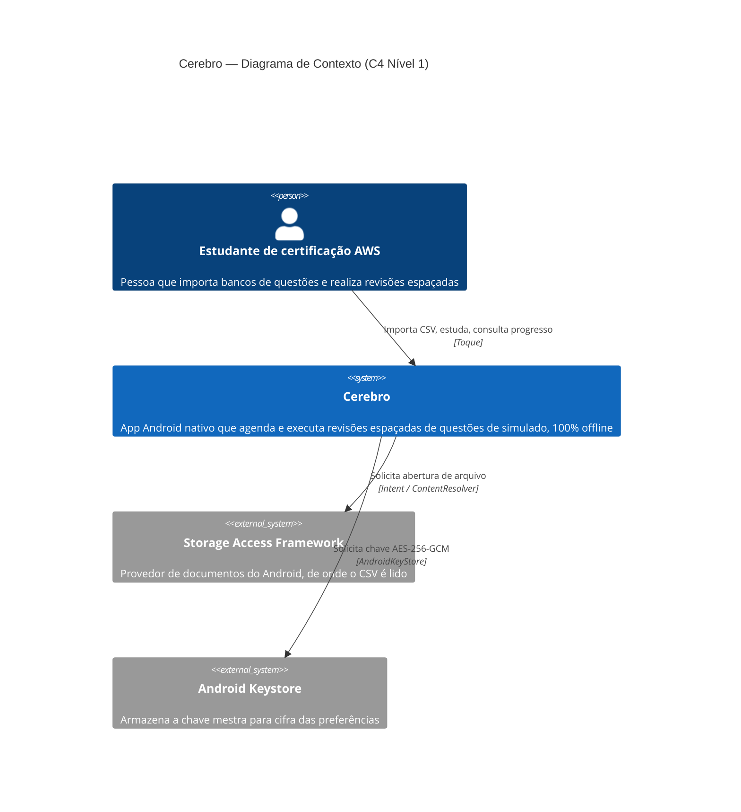
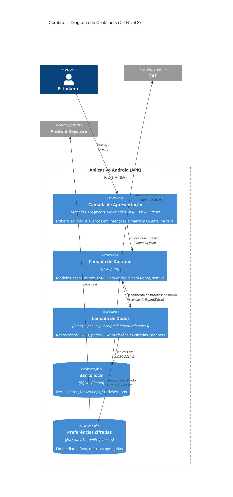
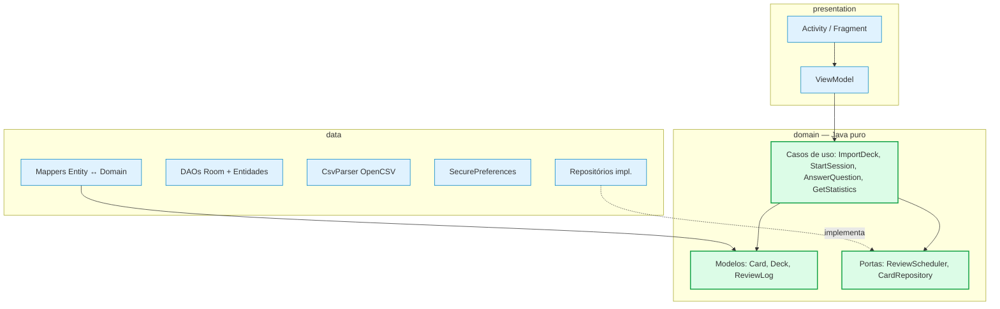
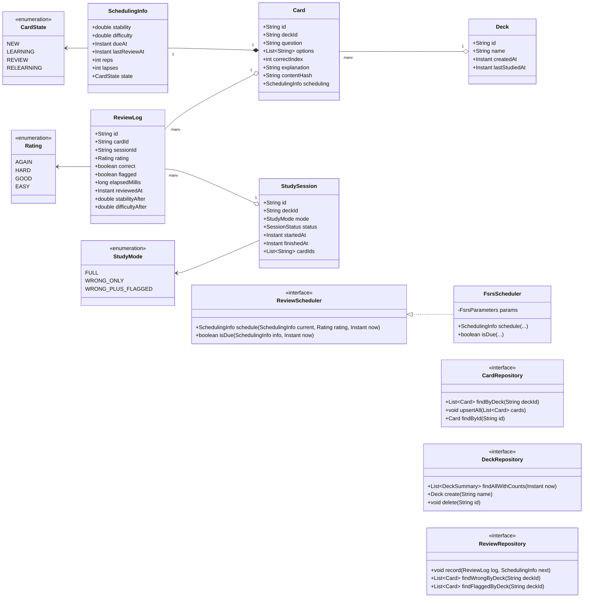
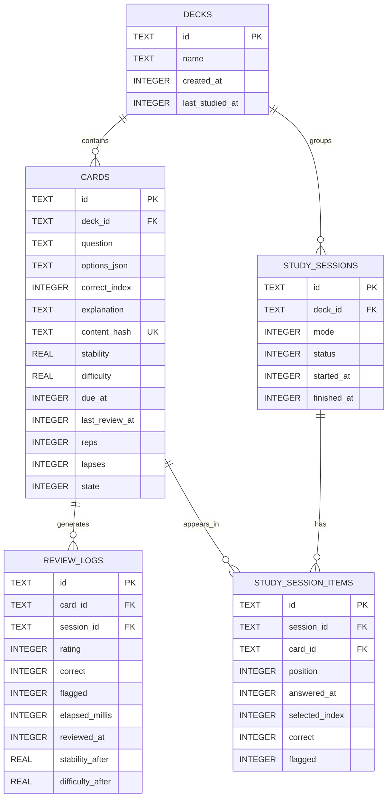
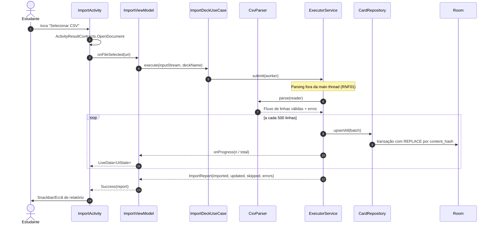
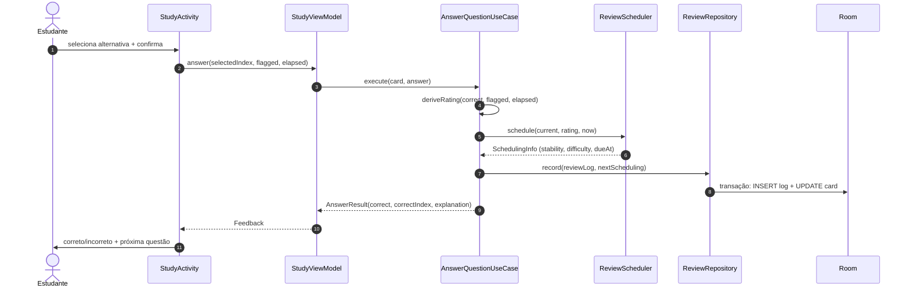

# Arquitetura do Sistema

| Campo | Valor |
|---|---|
| Versão | 1.0 |
| Issue de origem | [#5](https://github.com/MarkosFerreiraTech/android-spaced-repetition/issues/5) |
| ADRs | [adr/](./adr/) |
| Última revisão | 2026-11-06 |

---

## 1. Visão Geral

O **Cerebro** é um aplicativo **Android nativo em Java**, **offline-first**, organizado segundo **Clean Architecture** com o padrão de apresentação **MVVM**. Toda a inteligência de agendamento vive na **camada de domínio**, que é Java puro e não conhece Android.

O princípio estrutural é a **Regra de Dependência**: as setas apontam sempre para dentro. Domínio não importa nada de dados, apresentação ou framework. Isso é verificado automaticamente por testes de ArchUnit, não apenas por convenção.

## 2. C4 — Nível 1: Contexto

**Observação deliberada:** não existe nenhum sistema externo de backend, autenticação ou telemetria. A ausência é um requisito (RNF05), não uma omissão.

## 3. C4 — Nível 2: Containers

## 4. Camadas e Regra de Dependência

**Regras verificadas por ArchUnit:**

| Regra | Teste |
|---|---|
| `domain` não importa `android.*` | `ArchitectureTest.domainHasNoAndroidDependency` |
| `domain` não importa `androidx.room.*` | `ArchitectureTest.domainIsFrameworkFree` |
| `presentation` não importa `data` | `ArchitectureTest.presentationDoesNotDependOnData` |
| Nenhuma classe de domínio tem `@Entity` | `ArchitectureTest.domainModelsAreNotEntities` |
| Nenhum ViewModel instancia repositório | `ArchitectureTest.viewModelsReceiveCollaborators` |

## 5. Diagrama de Classes do Domínio

## 6. Modelo Entidade-Relacionamento (Room)

**Índices:** `CARDS(deck_id)`, `CARDS(due_at)`, `CARDS(content_hash)` UNIQUE, `REVIEW_LOGS(card_id)`, `REVIEW_LOGS(reviewed_at)`, `STUDY_SESSION_ITEMS(session_id, position)` UNIQUE.

## 7. Fluxo de Dados — Importação

## 8. Fluxo de Dados — Estudo e Agendamento

## 9. Arquitetura de Testes

| Nível | Ferramenta | Alvo | Execução |
|---|---|---|---|
| Unitário rápido | JUnit 5 + AssertJ + Mockito | Domínio, FSRS, casos de uso, ViewModels | `./gradlew test` (JVM, sem Android) |
| ViewModel | Robolectric + InstantTaskExecutorRule | `LiveData`, ciclo de vida | `./gradlew testDebugUnitTest` |
| Contrato de dados | Room in-memory | DAOs, mappers, migrações | `./gradlew connectedDebugAndroidTest` |
| UI | Espresso | Fluxos de importação, estudo, estatísticas | Instrumentado |
| Arquitetura | ArchUnit | Regra de dependência | `./gradlew test` |
| Cobertura | JaCoCo | Global ≥ 80%, domínio ≥ 95% | Job de CI |

## 10. Decisões Arquiteturais (ADRs)

| ADR | Decisão | Status |
|---|---|---|
| [ADR-001](./adr/ADR-001-fsrs-em-vez-de-sm2.md) | FSRS em vez de SM-2 | Aceito |
| [ADR-002](./adr/ADR-002-java-em-vez-de-kotlin.md) | Java em vez de Kotlin | Aceito |
| [ADR-003](./adr/ADR-003-room-e-opencsv.md) | Room + OpenCSV para persistência e importação | Aceito |
| [ADR-004](./adr/ADR-004-executorservice-em-vez-de-workmanager.md) | ExecutorService em vez de WorkManager | Aceito |
| [ADR-005](./adr/ADR-005-classificacao-de-dados-e-criptografia.md) | Classificação de dados e escopo da criptografia | Aceito com risco |
| [ADR-006](./adr/ADR-006-arquitetura-em-camadas-fisicas.md) | Camadas como pacotes, não módulos Gradle | Aceito com risco |
