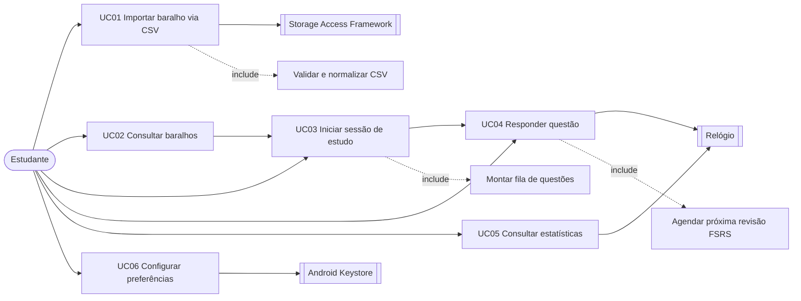

# Especificação de Casos de Uso

| Campo | Valor |
|---|---|
| Versão | 1.0 |
| Issue de origem | [#3](https://github.com/MarkosFerreiraTech/android-spaced-repetition/issues/3) |
| Rastreia | [Requisitos](./requisitos.md) → este documento → [User Stories](./user-stories.md) |
| Última revisão | 2026-11-06 |

---

## 1. Atores

| Ator | Tipo | Descrição | Interações |
|---|---|---|---|
| **Estudante** | Primário | Pessoa que importa bancos de questões e realiza sessões de revisão | UC01–UC06 |
| **Sistema de Arquivos (SAF)** | Secundário | Provedor de documentos do Android, de onde o CSV é lido | UC01 |
| **Relógio do Dispositivo** | Secundário | Fonte de tempo para o cálculo de "pendente hoje" e de intervalos | UC03, UC05 |
| **Android Keystore** | Secundário | Provedor de chave mestra para cifra das preferências | UC06 |

## 2. Visão Geral dos Casos de Uso

## 3. UC01 — Importar Baralho via CSV

| Campo | Descrição |
|---|---|
| **ID** | UC01 |
| **Ator primário** | Estudante |
| **Atores secundários** | Storage Access Framework, `ExecutorService` |
| **Requisitos** | RF01–RF08 |
| **Pré-condições** | O app está instalado e aberto na tela de importação |
| **Pós-condições de sucesso** | Baralho criado ou atualizado; cartões persistidos; relatório exibido |
| **Pós-condições de falha** | Nenhum cartão parcial gravado; baralho anterior intacto; mensagem de erro exibida |
| **Gatilho** | Estudante toca em "Selecionar CSV" |

### 3.1 Fluxo principal

1. O Estudante toca em **Selecionar CSV**.
2. O Sistema abre o seletor de documentos do Android (SAF) filtrando `text/csv` e `text/comma-separated-values`.
3. O Estudante escolhe um arquivo.
4. O Sistema abre um stream de entrada e lê a primeira linha para detectar BOM e separador.
5. O Sistema valida o cabeçalho contra o contrato (Anexo A dos requisitos).
6. O Sistema submete a leitura ao `ExecutorService` e exibe progresso indeterminado → determinado.
7. Para cada linha, o Sistema valida e converte em `Card` de domínio.
8. O Sistema calcula o `content_hash` e executa upsert em lotes de 500 dentro de uma transação.
9. O Sistema publica progresso a cada 500 linhas.
10. Ao final, o Sistema exibe o relatório: importados, atualizados, ignorados, erros.
11. O Sistema navega para a lista de baralhos com o novo baralho no topo.

### 3.2 Fluxos alternativos

**A1 — Cabeçalho fora do contrato (passo 5)**
- 5a. O Sistema aborta a leitura.
- 5b. O Sistema exibe a lista das colunas esperadas e as colunas encontradas.
- 5c. O Sistema oferece "Baixar modelo CSV" com o cabeçalho correto.

**A2 — Linha inválida (passo 7)**
- 7a. O Sistema registra `erro { linha: N, motivo: "gabarito inválido" }`.
- 7b. O Sistema continua a partir da linha seguinte.

**A3 — Arquivo grande (passo 6)**
- 6a. Se o arquivo exceder 50.000 linhas, o Sistema solicita confirmação.
- 6b. Se o Estudante confirmar, prossegue; caso contrário, encerra sem ler.

**A4 — Reimportação do mesmo arquivo (passo 8)**
- 8a. O Sistema encontra `content_hash` existente.
- 8b. O Sistema atualiza enunciado/alternativas mantendo `ReviewLog` e `stability`/`difficulty`.
- 8c. O Sistema incrementa o contador `updated` em vez de `imported`.

### 3.3 Fluxos de exceção

| # | Situação | Detecção | Tratamento |
|---|---|---|---|
| E1 | Arquivo indisponível ou removido durante a leitura | `IOException` no stream | Abortar, rollback do lote, mensagem "Arquivo indisponível. Selecione novamente." |
| E2 | Encoding inválido (não UTF-8/ISO-8859-1) | `MalformedInputException` | Tentar ISO-8859-1; se falhar, mensagem com dica de reexportação |
| E3 | CSV vazio ou somente cabeçalho | Linha de dados ausente | Mensagem "O arquivo não contém questões." sem criar baralho |
| E4 | Permissão de URI revogada | `SecurityException` | Mensagem "Sem acesso ao arquivo" e retorno à tela |
| E5 | Falha de escrita no banco | `SQLiteException` | Rollback do lote, manter baralho anterior, log sem dados sensíveis |
| E6 | Estudante cancela durante a leitura | Toque em "Cancelar" | `shutdownNow()` do executor, rollback do lote em andamento |
| E7 | Processo morto durante a importação | Ausência de conclusão no próximo início | Baralho marcado como `incompleto`; oferecer reimportação |
| E8 | Memória insuficiente em arquivo muito grande | `OutOfMemoryError` capturado no worker | Abortar com mensagem e sugerir divisão do arquivo |

---

## 4. UC02 — Consultar Baralhos

| Campo | Descrição |
|---|---|
| **ID** | UC02 |
| **Ator primário** | Estudante |
| **Requisitos** | RF09–RF11 |
| **Pré-condições** | Nenhuma |
| **Pós-condições** | Lista de baralhos exibida com contadores atualizados |
| **Gatilho** | App aberto ou retorno à tela inicial |

### 4.1 Fluxo principal

1. O Sistema consulta os baralhos com agregação de total de cartões e pendentes do dia.
2. O Sistema exibe a lista ordenada pela data da última atividade.
3. O Estudante toca em um baralho.
4. O Sistema exibe as opções de sessão (UC03).

### 4.2 Fluxos alternativos

**A1 — Nenhum baralho**
- 1a. O Sistema exibe estado vazio com explicação e botão "Importar CSV" (UC01).

**A2 — Nenhuma revisão pendente hoje**
- 2a. O Sistema exibe o baralho com selo "Em dia" e permite sessão no modo `COMPLETO`.

---

## 5. UC03 — Iniciar Sessão de Estudo

| Campo | Descrição |
|---|---|
| **ID** | UC03 |
| **Ator primário** | Estudante |
| **Requisitos** | RF12, RF18 |
| **Pré-condições** | Existe ao menos um baralho com ao menos uma questão respondível |
| **Pós-condições** | Sessão criada e persistida; primeira questão apresentada |
| **Gatilho** | Estudante escolhe um modo de sessão |

### 5.1 Fluxo principal

1. O Estudante escolhe o baralho e o modo: `COMPLETO`, `SOMENTE_ERROS`, `ERROS_MAIS_MARCADAS`.
2. O Sistema monta a fila:
   - `COMPLETO`: todas as questões do baralho, ordenadas por `due_at` crescente.
   - `SOMENTE_ERROS`: questões cujo último `ReviewLog` tem `correct = false`.
   - `ERROS_MAIS_MARCADAS`: união das erradas com as marcadas como "acertei com dúvida" na última tentativa.
3. O Sistema persiste a sessão com seus itens em ordem estável.
4. O Sistema apresenta a questão 1 (UC04).

### 5.2 Fluxos alternativos

**A1 — Fila vazia no modo `SOMENTE_ERROS`**
- 2a. O Sistema informa "Nenhum erro para revisar neste baralho" e sugere `COMPLETO`.

**A2 — Sessão anterior não concluída**
- 4a. O Sistema pergunta "Retomar sessão de ontem (12/27) ou começar nova?".
- 4b. Se retomar, reconstrói a fila a partir do item pendente.

### 5.3 Fluxos de exceção

| # | Situação | Tratamento |
|---|---|---|
| E1 | Baralho esvaziado por reimportação | Sessão encerrada com aviso; estatísticas preservadas |
| E2 | Data do dispositivo retrocedida | Questões ficam com `due_at` no futuro; Sistema exibe aviso de relógio inconsistente |

---

## 6. UC04 — Responder Questão

| Campo | Descrição |
|---|---|
| **ID** | UC04 |
| **Ator primário** | Estudante |
| **Requisitos** | RF13–RF17 |
| **Pré-condições** | Sessão em andamento com questão corrente definida |
| **Pós-condições** | `ReviewLog` gravado; agendamento FSRS atualizado; próxima questão ou resumo |
| **Gatilho** | Estudante seleciona alternativa e confirma |

### 6.1 Fluxo principal

1. O Sistema exibe enunciado, alternativas e progresso `n/total`.
2. O Estudante seleciona uma alternativa.
3. Opcionalmente, o Estudante marca **"acertei com dúvida"**.
4. O Estudante confirma.
5. O Sistema compara com o gabarito e deriva o rating:
   - Errou → `Again`
   - Acertou + marcada → `Hard`
   - Acertou → `Good`
   - Acertou sem marcação e abaixo de 40% do tempo médio histórico → `Easy`
6. O Sistema grava o `ReviewLog` e executa o `ReviewScheduler` (FSRS).
7. O Sistema persiste `stability`, `difficulty`, `due_at` e `state`.
8. O Sistema exibe feedback com a alternativa correta (e explicação, se houver).
9. Se houver próxima questão, volta ao passo 1; senão, exibe o resumo.

### 6.2 Fluxos alternativos

**A1 — Estudante abandona no meio**
- 1a. O estado é preservado; retomada por UC03/A2.

**A2 — Última questão**
- 9a. O Sistema exibe resumo com acertos, erros, marcadas, acurácia e botão "Refazer somente os erros".

### 6.3 Fluxos de exceção

| # | Situação | Tratamento |
|---|---|---|
| E1 | Confirmação sem alternativa selecionada | Botão permanece desabilitado |
| E2 | Falha ao gravar `ReviewLog` | Feedback não é exibido; mensagem de erro; questão não avança |
| E3 | App encerrado entre confirmação e persistência | Operação em transação única: ou ambos ocorrem, ou nenhum |

---

## 7. UC05 — Consultar Estatísticas

| Campo | Descrição |
|---|---|
| **ID** | UC05 |
| **Ator primário** | Estudante |
| **Requisitos** | RF19–RF21, RF25 |
| **Pré-condições** | Nenhuma |
| **Pós-condições** | Nenhuma (operação de leitura) |
| **Gatilho** | Estudante abre a aba de estatísticas |

### 7.1 Fluxo principal

1. O Sistema executa consultas agregadas no Room: acurácia global, acurácia por baralho, streak, total revisado, distribuição por dia.
2. O Sistema exibe os indicadores com formatação `pt-BR` e uma casa decimal na acurácia.
3. O Sistema destaca o baralho com pior desempenho.

### 7.2 Fluxos alternativos

**A1 — Sem dados**
- 1a. O Sistema exibe estado vazio com CTA "Começar a estudar".

### 7.3 Fluxos de exceção

| # | Situação | Tratamento |
|---|---|---|
| E1 | Fuso horário alterado entre sessões | Agregação por dia usa o fuso configurado no momento da consulta; aviso exibido |

---

## 8. UC06 — Configurar Preferências

| Campo | Descrição |
|---|---|
| **ID** | UC06 |
| **Ator primário** | Estudante |
| **Atores secundários** | Android Keystore |
| **Requisitos** | RF22–RF24 |
| **Pré-condições** | Nenhuma |
| **Pós-condições** | Preferências persistidas cifradas |
| **Gatilho** | Estudante abre as configurações |

### 8.1 Fluxo principal

1. O Sistema lê as preferências de `EncryptedSharedPreferences`.
2. O Sistema exibe o limite diário de questões novas e o fuso horário.
3. O Estudante altera um valor.
4. O Sistema grava cifrado e confirma com `Snackbar`.

### 8.2 Fluxos de exceção

| # | Situação | Tratamento |
|---|---|---|
| E1 | Keystore indisponível (dispositivo incompatível) | Sistema informa que as preferências não serão cifradas e bloqueia a gravação de novos valores sensíveis |
| E2 | Chave invalidada após restauração de backup | Sistema recria as preferências com valores padrão e informa o ocorrido |

---

## 9. Matriz de Rastreabilidade

| Caso de uso | Requisitos | User stories | Issues |
|---|---|---|---|
| UC01 | RF01–RF08, RNF01, RNF02, RNF07 | US01, US02 | #11, #12 |
| UC02 | RF09–RF11, RNF03 | US03 | #10, #12 |
| UC03 | RF12, RF18 | US04, US06 | #13 |
| UC04 | RF13–RF17, RNF04, RNF06 | US04, US05 | #8, #13 |
| UC05 | RF19–RF21, RF25 | US07, US09 | #14 |
| UC06 | RF22–RF24, RNF12 | US08 | #15 |
